<div align="center">

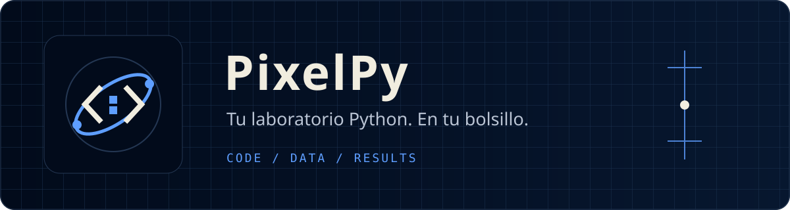

# PixelPy

### Tu laboratorio Python. En tu bolsillo.

Escribe scripts, explora datos y convierte ideas en resultados desde Android. PixelPy reúne editor, notebooks y automatizaciones en un espacio de trabajo local con una identidad visual propia.

[Descargar releases](https://github.com/rck1996/PixelPy-Android/releases) · [Guía de notebooks](docs/notebook.md) · [Resultados y widgets](docs/resultados-publicados.md) · [Identidad visual](docs/identidad-visual.md)

Consulta también los [recorridos y criterios de experiencia de usuario](docs/experiencia-de-usuario.md).


> **Distribución:** la última versión publicada sigue siendo **1.8.0**. Orbit Code y las mejoras documentadas aquí están en desarrollo; una captura de prueba no representa una release. Revisa [Releases](https://github.com/rck1996/PixelPy-Android/releases) para descargar la versión estable.

[Recorrido](#capturas) · [Empezar](#primeros-pasos) · [Compilar](#compilar) · [Calidad](#calidad) · [Documentación](#documentación)

</div>

## De una idea a un resultado

| Quiero… | Abrir | Siguiente paso |
| --- | --- | --- |
| Escribir Python | Editor | Toca un script en Proyectos y ejecuta |
| Explorar datos por etapas | Notebook | Selecciona o importa un `.ipynb` |
| Consultar un archivo | Recursos | Elige la carpeta y abre su vista previa |
| Repetir un proceso | Automatizaciones | Configura horario y revisa su historial |
| Probar una expresión | REPL | Ejecuta comandos en la sesión del proyecto |

| Trabaja | Explora | Automatiza |
| --- | --- | --- |
| Organiza scripts y recursos por proyecto. Edita con autoguardado y ejecuta Python localmente. | Importa notebooks, consulta CSV y JSON, y genera gráficos SVG desde tus datos. | Programa scripts y consulta sus resultados desde el historial o el widget. |

## Primeros pasos

1. Crea un proyecto e importa tus scripts o archivos de datos.
2. Abre el editor para un script o el notebook para trabajar por celdas.
3. Ejecuta y revisa la salida, las variables y los archivos generados.
4. Comparte el resultado o configura una automatización para repetir el trabajo.

El diseño conserva bordes definidos, colores por contexto y acciones secundarias en menús. En Data Lab, el encabezado muestra el progreso de ejecución y mantiene el acceso al selector de notebooks.

## Cómo se conectan las herramientas

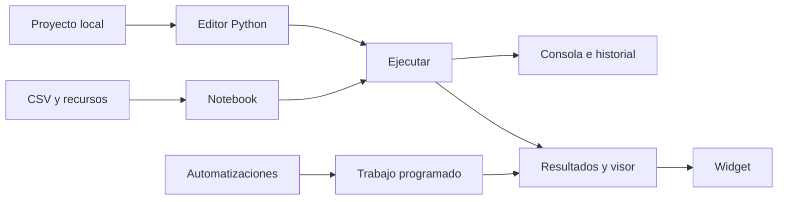

El mismo proyecto alimenta scripts, notebooks y automatizaciones; la consola explica qué ocurrió y el visor muestra los archivos generados. Para la implementación y sus límites, consulta [Arquitectura](docs/arquitectura.md).

## Funciones

<details>
<summary>Explorar todas las herramientas de PixelPy</summary>

- Editor multifichero con resaltado, búsqueda, autocompletado y versiones.
- Proyectos con scripts y recursos CSV, JSON, Excel, imágenes, TXT y ZIP.
- Ejecución local con `input()`, detención, análisis previo y depuración de variables.
- Consola separada en salida, variables y errores.
- REPL persistente por proyecto.
- Importación y exportación de proyectos ZIP.
- Respaldos completos por proyecto, restauración validada y retención automática de las cinco versiones más recientes.
- Perfiles de librerías integrados y comprobados en la app: Core, Web, Excel y Data Lab.
- Autosave seguro con recuperación de proyecto, archivo, pestaña y cursor.
- Automatizaciones únicas, diarias o semanales mediante WorkManager, con restricciones de red, carga y batería.
- Publicación segura de resultados y widget para consultar el estado, ejecutar el script y ver el último archivo generado.
- Visor integrado con búsqueda para texto, Markdown renderizado, JSON plegable, CSV en tabla, zoom de imágenes, explorador ZIP y vista básica de la primera hoja de Excel.
- Los archivos generados por una ejecución normal aparecen en una galería horizontal y pueden abrirse en el mismo visor directamente desde la consola.
- Historial persistente de ejecuciones con código, salida y copias de resultados; permite fijar, comparar, borrar y exportar una sesión completa como ZIP.
- Parámetros guardados por automatización (`CLAVE=valor`) y notificaciones de finalización con acceso directo al resultado.
- Parámetros visuales tipados (texto, número, sí/no y secreto), además de repetición manual con valores temporales.
- Historial detallado con código, salida, duración, archivos y diferencias reales línea por línea.
- Plantillas favoritas para APIs, CSV, Excel, gráficos, scraping y automatizaciones.
- Gestor de recursos con carpetas visibles aunque estén vacías, importación al destino elegido, selección múltiple, movimiento y renombrado seguros, rutas relativas copiables, papelera y vista previa.
- Al mover o renombrar un resultado destacado, PixelPy actualiza automáticamente la automatización que lo utiliza.
- Notebook local por proyecto con resultados estructurados, inspector resumido de variables, archivos asociados a su celda y constructor de gráficos SVG desde CSV; si falta el CSV, el flujo permite importarlo sin salir del constructor.
- Interfaz compacta por contexto: Scripts y Recursos separados, acciones secundarias en menús, editor optimizado para el teclado y resultados plegables.
- Modos oscuro y claro con contraste alto opcional y tres densidades de interfaz.
- Diagnóstico de automatizaciones con historial local, causa visible en el widget, reintento y copia del reporte.
- Identidad visual compartida: navy y azul eléctrico en oscuro; papel cálido y terracota en claro, con retícula técnica y órbitas en ambos temas.

La interfaz mantiene una sola acción principal visible por elemento. Compartir, renombrar, duplicar, eliminar y las opciones avanzadas permanecen disponibles en `⋮` o en secciones desplegables para aprovechar mejor las pantallas pequeñas. El fondo usa una retícula y un diagrama orbital tenues; no emplea imágenes decorativas de terceros detrás del código o los datos.

</details>

## Capturas

Capturas reales de dispositivos Android. Las propuestas conceptuales anteriores están separadas en [Exploración de diseño](docs/design-proposals/README.md); la implementación actual sigue el sistema Orbit Code.

<details>
<summary>Ver capturas Orbit Code · Samsung Tab S8</summary>

El índice de [capturas por dispositivo, pantalla y tema](docs/screenshots/README.md) documenta el origen de cada imagen.

<p align="center">
  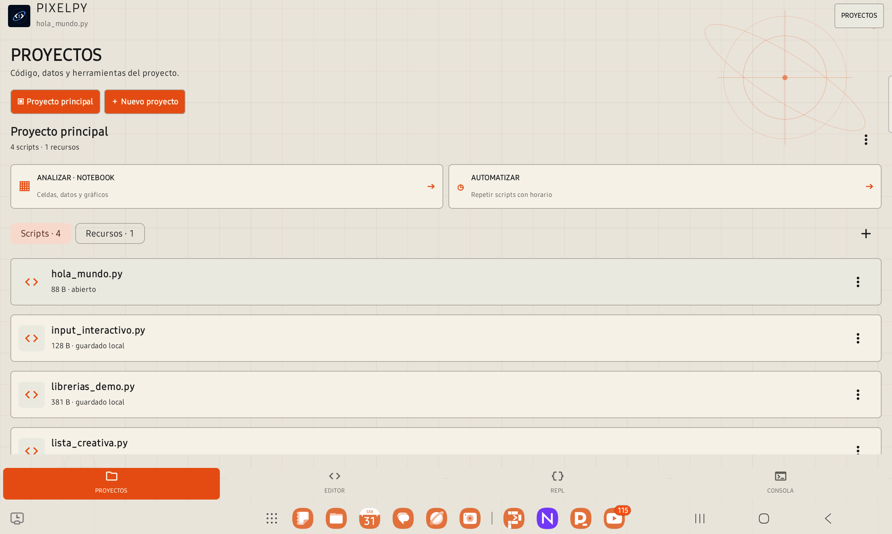
  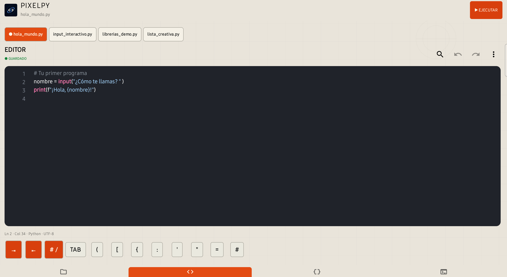
  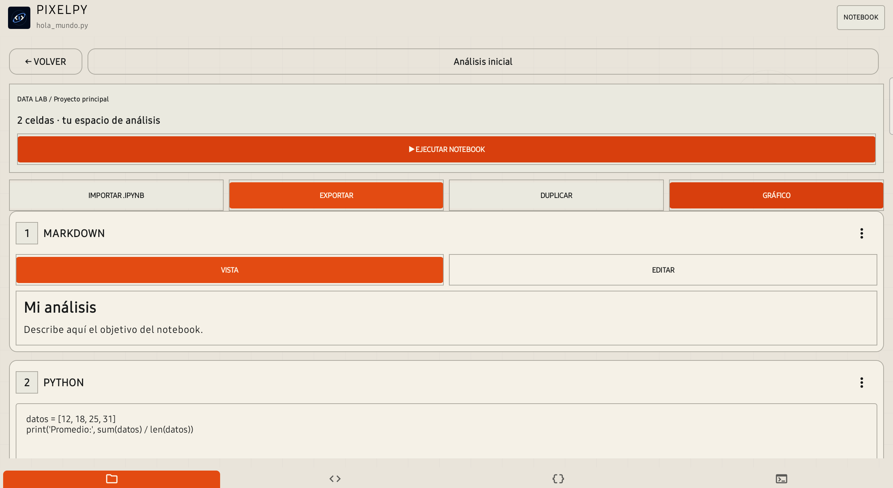
</p>

<p align="center">
  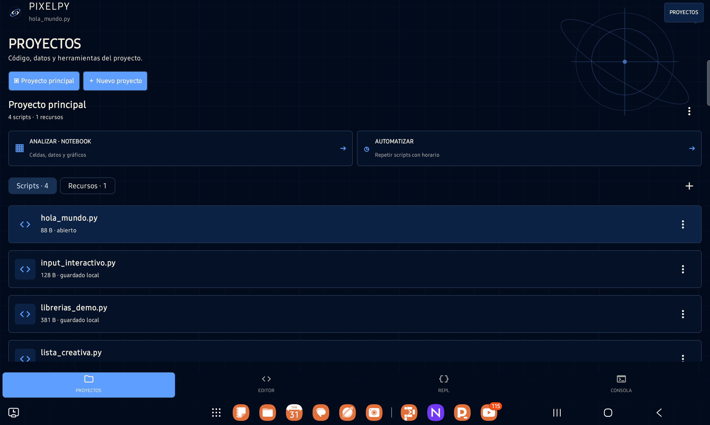
  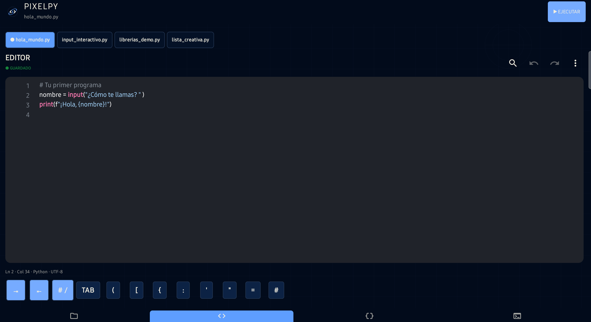
  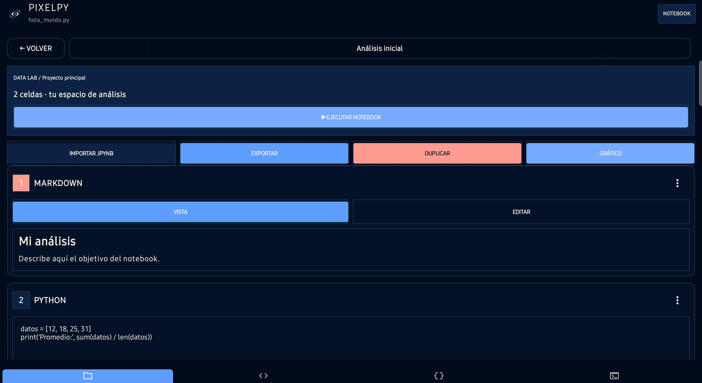
</p>

<p align="center">
  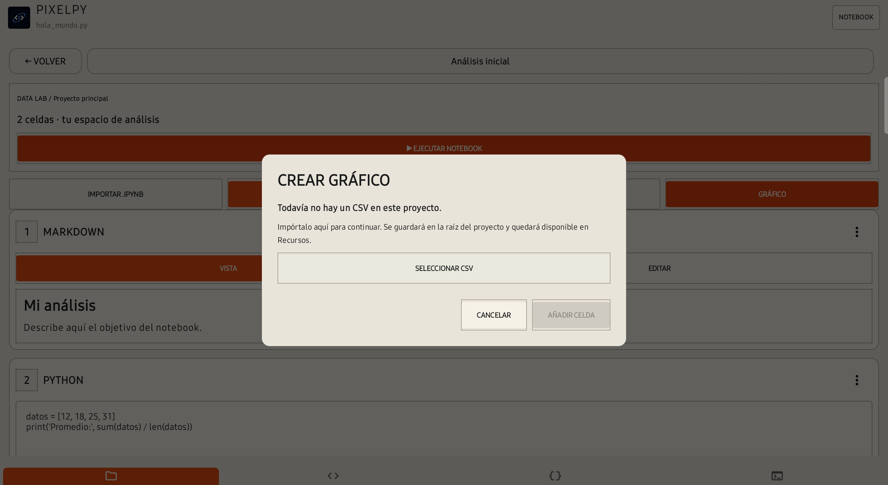
  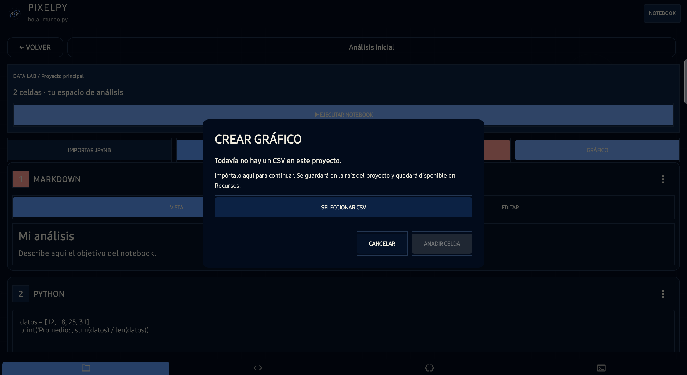
</p>

Consulta el flujo, Markdown compatible y límites del MVP en [Notebook local](docs/notebook.md).

</details>

<details open>
<summary>Ver capturas Orbit Code · Galaxy S25+</summary>

Galería del teléfono real (Android 16); cada pantalla se presenta en modo claro y oscuro.

<p align="center">
  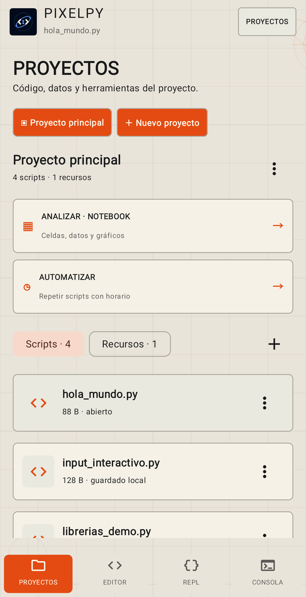
  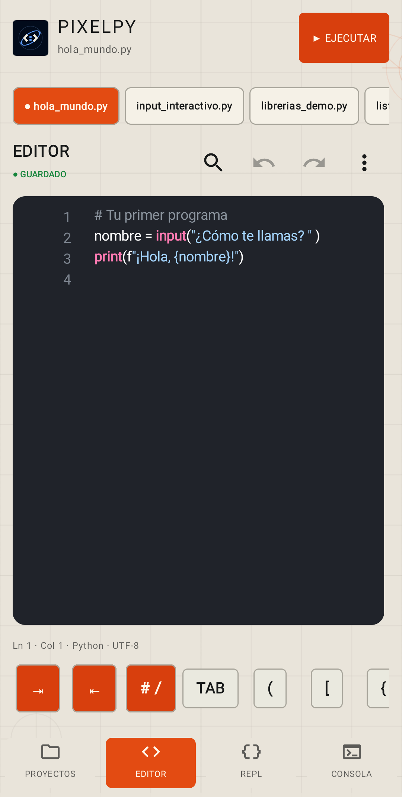
  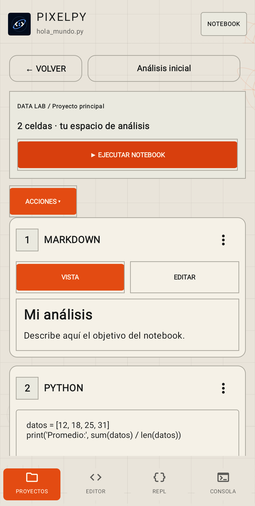
</p>

<p align="center">
  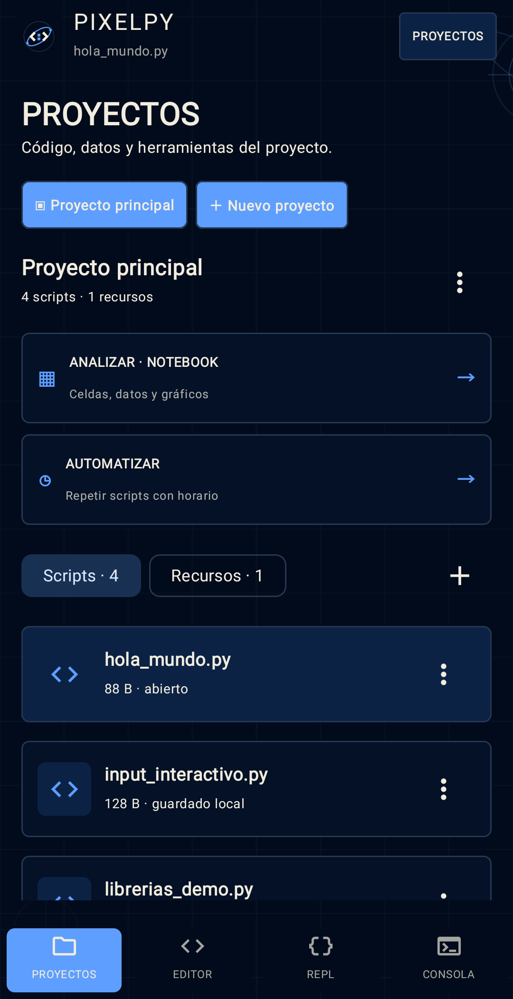
  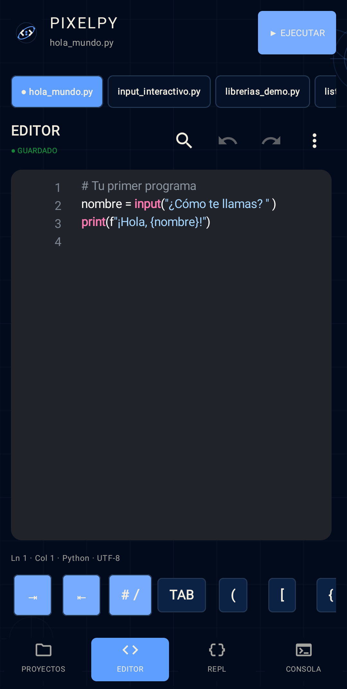
  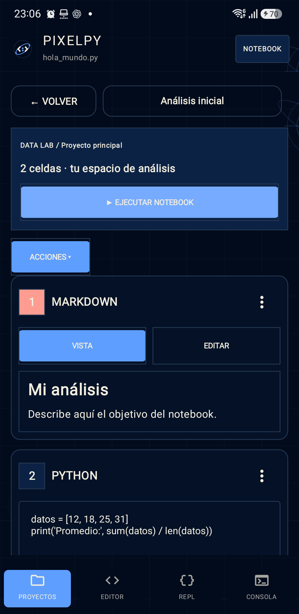
</p>

<p align="center">
  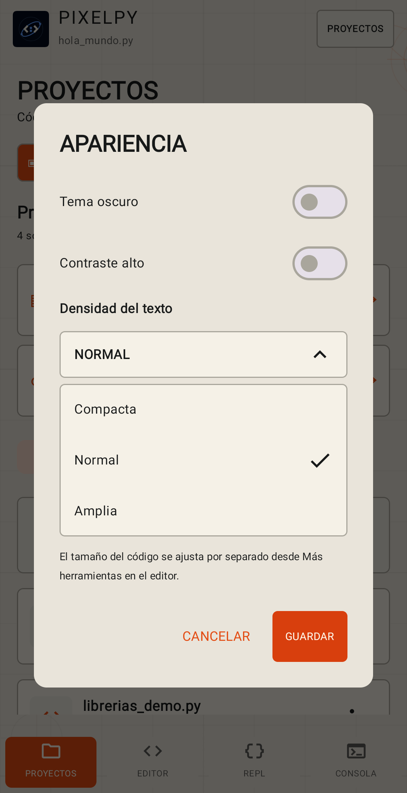
</p>

El [índice de capturas](docs/screenshots/README.md) identifica equipo, tema y límites de QA.

</details>

## Orbit Code · identidad


El símbolo une delimitadores de código, nodos de datos y una órbita. Oscuro y claro comparten retícula técnica, líneas finas, jerarquía y componentes: el primero usa azul eléctrico sobre navy; el segundo, terracota sobre papel cálido. La retícula y el diagrama orbital se dibujan nativamente; las capturas muestran la app real. Consulta la [guía de identidad visual](docs/identidad-visual.md) para la paleta y el uso de marca.

## Resultados publicados

El botón **VER RESULTADO** del widget, **ABRIR RESULTADO** en automatizaciones y **VER RESULTADO** en la consola llevan al mismo visor:

- TXT, LOG y XML se muestran como texto con búsqueda.
- Markdown presenta títulos, listas, citas y bloques con jerarquía visual.
- JSON se presenta como un árbol interactivo con objetos y listas plegables.
- CSV se muestra como tabla filtrable con encabezados, filas alternadas y desplazamiento horizontal.
- PNG, JPG, JPEG y WebP permiten zoom táctil dentro de PixelPy.
- SVG y HTML se previsualizan como gráficos locales; SVG incluye ajuste al ancho, zoom y exportación PNG.
- ZIP muestra su contenido sin extraerlo y XLSX ofrece una vista básica de la primera hoja.
- PDF y formatos desconocidos ofrecen **OTRA APP**.
- Todos los formatos pueden compartirse desde el visor.

La vista previa textual está limitada a 1 MB para evitar bloqueos. El visor siempre usa la copia publicada en el almacenamiento privado de PixelPy, no el archivo que el script podría estar modificando.

En la consola normal se abre el archivo generado dentro del proyecto. En automatizaciones y widgets se abre una copia publicada estable.

Consulta el flujo completo y la resolución de problemas en [Resultados publicados y widget](docs/resultados-publicados.md).

## Requisitos

- Android 8.0 o superior.
- Compilación y SDK objetivo: Android 16 (API 36).
- Dispositivo ARM64.
- Android Studio con JDK 17.
- Python 3.13 instalado en el equipo de compilación para Chaquopy.

## Compilar

```powershell
.\gradlew.bat :pyeditor:assembleDevelopmentDebug
```

El APK se genera en `pyeditor/build/outputs/apk/development/debug/`.

## Versión

La versión más reciente publicada sigue siendo `1.8.0` (Pixel Studio / Pixel Spark). El rediseño Orbit Code está en desarrollo y aún no se distribuye como release. Consulta [Releases](https://github.com/rck1996/PixelPy-Android/releases) para verificar APKs publicados.

Las ejecuciones programadas son aproximadas: Android puede retrasarlas por batería, Doze o restricciones del sistema.

Los parámetros guardados se exponen durante la ejecución como variables de entorno. Por ejemplo, `CIUDAD=Santiago` se consulta en Python con `os.getenv("CIUDAD")`; PixelPy restaura el entorno al terminar.

## Privacidad

Los proyectos, automatizaciones y resultados publicados se guardan localmente. PixelPy solo usa Internet cuando un script del usuario realiza una solicitud de red.

## Calidad

| Build | Resultado | Evidencia |
| --- | --- | --- |
| Release estable 1.8.0 | 67 pruebas unitarias; instalación, navegación y `input()` en Galaxy S25+ · Android 16 | [Recorridos y verificación histórica](docs/experiencia-de-usuario.md) |
| Vista previa Orbit Code · 2026-10-31 | 76 pruebas, lint y APK de desarrollo completados; revisión visual en Tab S8 y Galaxy S25+ | [Informe de QA](docs/QA_REPORT.md) |
| Cobertura por completar | Accesibilidad exhaustiva, variaciones de ventana y todos los escenarios de segundo plano | [Límites de validación](docs/experiencia-de-usuario.md) |

El badge superior informa CI; las filas describen verificaciones locales de builds identificadas por separado. No presentan la vista previa como release.

## Documentación

| Para usar PixelPy | Para conocer el proyecto |
| --- | --- |
| [Notebook y gráficos](docs/notebook.md) | [Diseño y recorridos](docs/experiencia-de-usuario.md) |
| [Editor y atajos móviles](docs/editor.md) | [Identidad visual Orbit Code](docs/identidad-visual.md) |
| [Resultados y widget](docs/resultados-publicados.md) | [Código fuente](pyeditor/src/main/java/com/pixelpy/editor/) |
| [Descargas](https://github.com/rck1996/PixelPy-Android/releases) | [Notas históricas de 1.8.0](docs/release-1.8.0.md) |
| [Exploración de diseño anterior](docs/design-proposals/README.md) | |

El [índice de documentación](docs/README.md) agrupa las guías por tarea, referencia y evidencia, siguiendo la estructura de producto de [NexusOS](https://github.com/rck1996/NexusOS).
