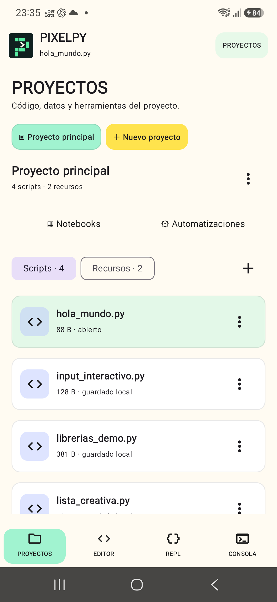
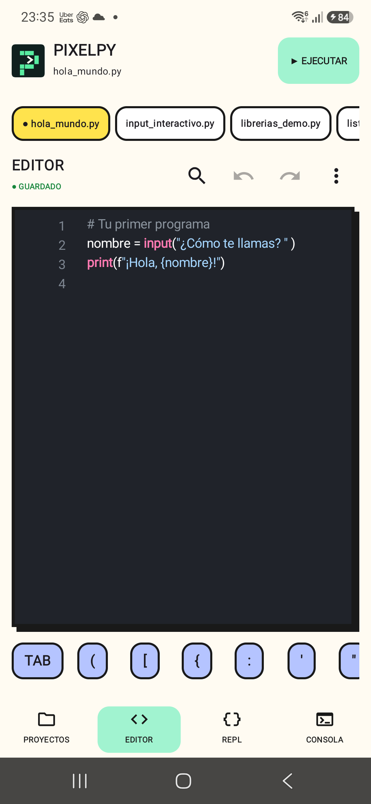
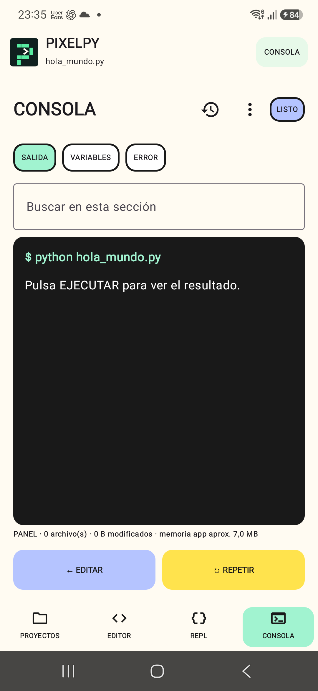
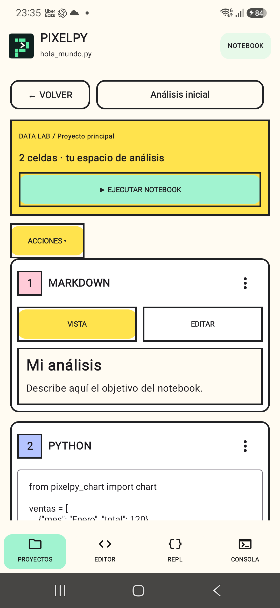

<div align="center">


# PixelPy

### Tu laboratorio Python. En tu bolsillo.

Escribe scripts, explora datos y convierte ideas en resultados desde Android. PixelPy reúne editor, notebooks y automatizaciones en un espacio de trabajo local con una identidad visual propia.

[Descargar releases](https://github.com/rck1996/PixelPy-Android/releases) · [Guía de notebooks](docs/notebook.md) · [Resultados y widgets](docs/resultados-publicados.md)

Consulta también los [recorridos y criterios de experiencia de usuario](docs/experiencia-de-usuario.md).


[Recorrido](#capturas) · [Empezar](#primeros-pasos) · [Compilar](#compilar) · [Calidad](#calidad) · [Documentación](#documentación)

</div>

## De una idea a un resultado

| Quiero… | Abrir | Siguiente paso |
| --- | --- | --- |
| Escribir Python | Editor | Toca un script en Proyectos y ejecuta |
| Explorar datos por etapas | Notebook | Selecciona o importa un `.ipynb` |
| Consultar un archivo | Recursos | Elige la carpeta y abre su vista previa |
| Repetir un proceso | Automatizaciones | Configura horario y revisa su historial |
| Probar una expresión | REPL | Ejecuta comandos en la sesión del proyecto |

| Trabaja | Explora | Automatiza |
| --- | --- | --- |
| Organiza scripts y recursos por proyecto. Edita con autoguardado y ejecuta Python localmente. | Importa notebooks, consulta CSV y JSON, y genera gráficos SVG desde tus datos. | Programa scripts y consulta sus resultados desde el historial o el widget. |

## Primeros pasos

1. Crea un proyecto e importa tus scripts o archivos de datos.
2. Abre el editor para un script o el notebook para trabajar por celdas.
3. Ejecuta y revisa la salida, las variables y los archivos generados.
4. Comparte el resultado o configura una automatización para repetir el trabajo.

El diseño conserva bordes definidos, colores por contexto y acciones secundarias en menús. En Data Lab, el encabezado muestra el progreso de ejecución y mantiene el acceso al selector de notebooks.

## Funciones

<details>
<summary>Explorar todas las herramientas de PixelPy</summary>

- Editor multifichero con resaltado, búsqueda, autocompletado y versiones.
- Proyectos con scripts y recursos CSV, JSON, Excel, imágenes, TXT y ZIP.
- Ejecución local con `input()`, detención, análisis previo y depuración de variables.
- Consola separada en salida, variables y errores.
- REPL persistente por proyecto.
- Importación y exportación de proyectos ZIP.
- Respaldos completos por proyecto, restauración validada y retención automática de las cinco versiones más recientes.
- Perfiles de librerías integrados y comprobados en la app: Core, Web, Excel y Data Lab.
- Autosave seguro con recuperación de proyecto, archivo, pestaña y cursor.
- Automatizaciones únicas, diarias o semanales mediante WorkManager, con restricciones de red, carga y batería.
- Publicación segura de resultados y widget para consultar el estado, ejecutar el script y ver el último archivo generado.
- Visor integrado con búsqueda para texto, Markdown renderizado, JSON plegable, CSV en tabla, zoom de imágenes, explorador ZIP y vista básica de la primera hoja de Excel.
- Los archivos generados por una ejecución normal aparecen en una galería horizontal y pueden abrirse en el mismo visor directamente desde la consola.
- Historial persistente de ejecuciones con código, salida y copias de resultados; permite fijar, comparar, borrar y exportar una sesión completa como ZIP.
- Parámetros guardados por automatización (`CLAVE=valor`) y notificaciones de finalización con acceso directo al resultado.
- Parámetros visuales tipados (texto, número, sí/no y secreto), además de repetición manual con valores temporales.
- Historial detallado con código, salida, duración, archivos y diferencias reales línea por línea.
- Plantillas favoritas para APIs, CSV, Excel, gráficos, scraping y automatizaciones.
- Gestor de recursos con carpetas visibles aunque estén vacías, importación al destino elegido, selección múltiple, movimiento y renombrado seguros, rutas relativas copiables, papelera y vista previa.
- Al mover o renombrar un resultado destacado, PixelPy actualiza automáticamente la automatización que lo utiliza.
- Notebook local por proyecto con resultados estructurados, inspector resumido de variables, archivos asociados a su celda y constructor de gráficos SVG desde CSV.
- Interfaz compacta por contexto: Scripts y Recursos separados, acciones secundarias en menús, editor optimizado para el teclado y resultados plegables.
- Tema oscuro, contraste alto y tres densidades de interfaz.
- Diagnóstico de automatizaciones con historial local, causa visible en el widget, reintento y copia del reporte.
- Interfaz neobrutalista optimizada para teclado móvil.

La interfaz mantiene una sola acción principal visible por elemento. Compartir, renombrar, duplicar, eliminar y las opciones avanzadas permanecen disponibles en `⋮` o en secciones desplegables para aprovechar mejor las pantallas pequeñas.

</details>

## Capturas

Capturas reales del Samsung S25+ con Android 16. Las propuestas conceptuales están separadas en [Exploración de diseño](docs/design-proposals/README.md).

<details open>
<summary>Ver la galería del teléfono</summary>

<p align="center">
  
  
  
</p>

<p align="center">
  
  
</p>

Consulta el flujo, Markdown compatible y límites del MVP en [Notebook local](docs/notebook.md).

</details>

## Pixel Spark · identidad


La P modular y el terminal representan el paso de código a resultados. Pixel Studio utiliza crema, menta, amarillo y periwinkle; el icono Android incluye una variante monocroma.

## Resultados publicados

El botón **VER RESULTADO** del widget, **ABRIR RESULTADO** en automatizaciones y **VER RESULTADO** en la consola llevan al mismo visor:

- TXT, LOG y XML se muestran como texto con búsqueda.
- Markdown presenta títulos, listas, citas y bloques con jerarquía visual.
- JSON se presenta como un árbol interactivo con objetos y listas plegables.
- CSV se muestra como tabla filtrable con encabezados, filas alternadas y desplazamiento horizontal.
- PNG, JPG, JPEG y WebP permiten zoom táctil dentro de PixelPy.
- SVG y HTML se previsualizan como gráficos locales; SVG incluye ajuste al ancho, zoom y exportación PNG.
- ZIP muestra su contenido sin extraerlo y XLSX ofrece una vista básica de la primera hoja.
- PDF y formatos desconocidos ofrecen **OTRA APP**.
- Todos los formatos pueden compartirse desde el visor.

La vista previa textual está limitada a 1 MB para evitar bloqueos. El visor siempre usa la copia publicada en el almacenamiento privado de PixelPy, no el archivo que el script podría estar modificando.

En la consola normal se abre el archivo generado dentro del proyecto. En automatizaciones y widgets se abre una copia publicada estable.

Consulta el flujo completo y la resolución de problemas en [Resultados publicados y widget](docs/resultados-publicados.md).

## Requisitos

- Android 8.0 o superior.
- Compilación y SDK objetivo: Android 16 (API 36).
- Dispositivo ARM64.
- Android Studio con JDK 17.
- Python 3.13 instalado en el equipo de compilación para Chaquopy.

## Compilar

```powershell
.\gradlew.bat :pyeditor:assembleDevelopmentDebug
```

El APK se genera en `pyeditor/build/outputs/apk/development/debug/`.

## Versión

La versión configurada en el código es `1.8.0`: identidad Pixel Studio, logo Pixel Spark y SDK objetivo Android 16. Consulta [Releases](https://github.com/rck1996/PixelPy-Android/releases) para comprobar qué compilaciones están publicadas.

Las ejecuciones programadas son aproximadas: Android puede retrasarlas por batería, Doze o restricciones del sistema.

Los parámetros guardados se exponen durante la ejecución como variables de entorno. Por ejemplo, `CIUDAD=Santiago` se consulta en Python con `os.getenv("CIUDAD")`; PixelPy restaura el entorno al terminar.

## Privacidad

Los proyectos, automatizaciones y resultados publicados se guardan localmente. PixelPy solo usa Internet cuando un script del usuario realiza una solicitud de red.

## Calidad

| Comprobación registrada | Resultado |
| --- | --- |
| Pruebas unitarias | 67 sin fallos en la validación de 1.8.0 |
| Compilación y lint | Completados localmente |
| S25+ · Android 16 | Instalación, navegación y ejecución con `input()` comprobadas |
| Cobertura adicional | Accesibilidad exhaustiva y todos los escenarios de segundo plano pendientes |

El badge superior muestra CI en vivo; esta tabla describe las comprobaciones locales registradas. [Recorridos y límites de validación](docs/experiencia-de-usuario.md).

## Documentación

| Para usar PixelPy | Para conocer el proyecto |
| --- | --- |
| [Notebook y gráficos](docs/notebook.md) | [Diseño y recorridos](docs/experiencia-de-usuario.md) |
| [Resultados y widget](docs/resultados-publicados.md) | [Notas de 1.8.0](docs/release-1.8.0.md) |
| [Descargas](https://github.com/rck1996/PixelPy-Android/releases) | [Propuestas de diseño](docs/design-proposals/README.md) |

La presentación sigue el enfoque de [NexusOS](https://github.com/rck1996/NexusOS): navegación por intención, evidencia real y galerías plegables.
