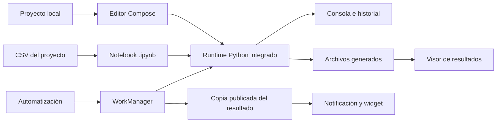

# Arquitectura de PixelPy

PixelPy es una app Android nativa y local-first. La interfaz Compose trabaja sobre proyectos privados del dispositivo; el runtime Python integrado ejecuta scripts y celdas sin enviar su contenido a un servicio de PixelPy.

## Recorrido de una ejecución

El editor y Data Lab reutilizan el runtime integrado. La consola presenta la salida, errores y variables; las ejecuciones guardan sesiones con código, duración y artefactos. Las automatizaciones delegan el disparo a WorkManager y validan que las rutas permanezcan dentro de los proyectos de PixelPy. Los resultados que expone un widget o una automatización se publican como una copia en almacenamiento privado para que el visor no lea un archivo que el script esté modificando.

## Componentes

| Capa | Responsabilidad | Implementación principal |
| :--- | :--- | :--- |
| Presentación | Navegación, edición, Data Lab, consola y visor | Jetpack Compose, `MainActivity`, `NotebookScreen`, `AutomationScreen` |
| Runtime | Inicio de Python y serialización de acceso al intérprete | Chaquopy, `PixelPyApp`, `PythonRuntimeCoordinator` |
| Proyectos | Scripts, notebooks, recursos, versiones y papelera | `filesDir/projects/` y operaciones validadas de archivo |
| Ejecuciones | Salida, historial y copias de artefactos | `ExecutionSessionStore` y `PublishedArtifactPublisher` |
| Automatización | Definiciones locales, validación de rutas y planificación | `AutomationRepository`, `AutomationScheduler`, WorkManager |
| Ajustes de interfaz | Tema, escala y preferencias locales | Preferencias Android privadas |

Las automatizaciones se guardan en `filesDir/automations/`; sus rutas de scripts y resultados se validan contra la raíz de proyectos. El visor y el widget consumen copias publicadas bajo el almacenamiento privado de la app.

## Privacidad y límites

- Proyectos, historial y resultados permanecen en el dispositivo por defecto.
- PixelPy no sincroniza proyectos automáticamente con la nube. El acceso a Internet puede ocurrir si el script del usuario realiza solicitudes de red o si el usuario usa explícitamente una función externa habilitada.
- Las automatizaciones no garantizan una hora exacta: Doze, ahorro de batería y políticas del fabricante pueden retrasar WorkManager.
- Las librerías Python disponibles dependen de los perfiles y paquetes incluidos en la build. Las propuestas visuales no garantizan que una dependencia esté instalada.
- Las copias publicadas son resultados exportados por PixelPy, no una segunda fuente editable del proyecto.

## Validación

Las pruebas unitarias cubren reglas y operaciones locales; lint revisa problemas estáticos y la compilación produce la build. Ninguno sustituye la revisión visual o de interacción en cada tamaño de pantalla. La [galería de capturas](screenshots/README.md) y la [experiencia de usuario](experiencia-de-usuario.md) indican qué dispositivo se comprobó y qué queda fuera de esa revisión.

Para compilar, requisitos y rutas del APK, consulta la sección **Compilar** del [README](../README.md#compilar). La configuración local del SDK y las claves de firma no se publican en el repositorio.
