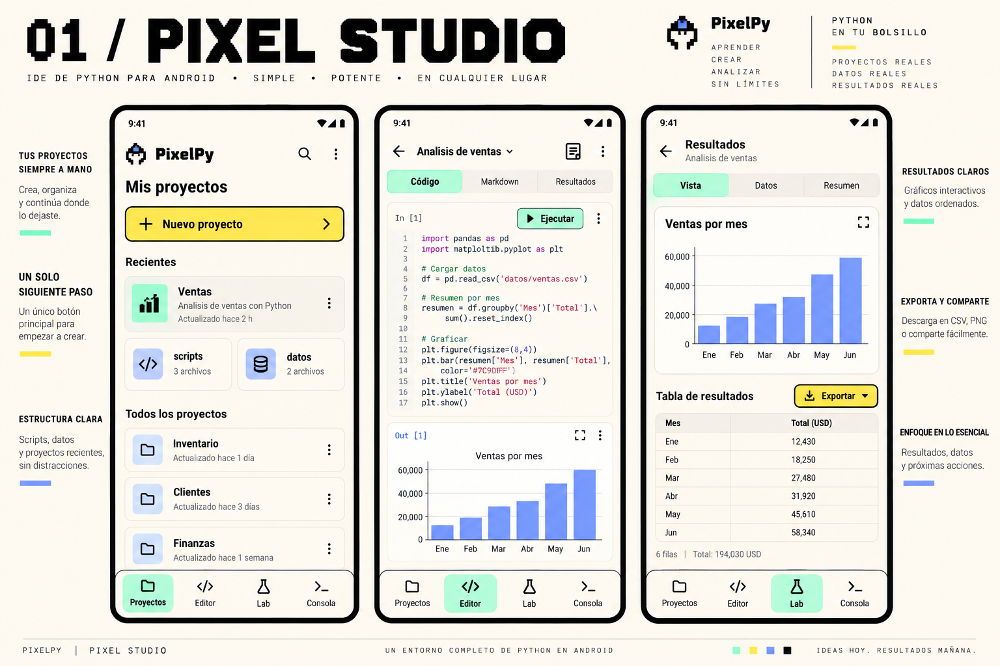
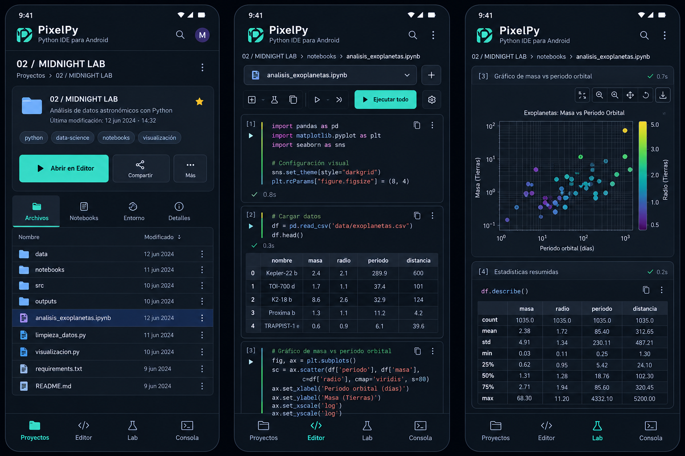
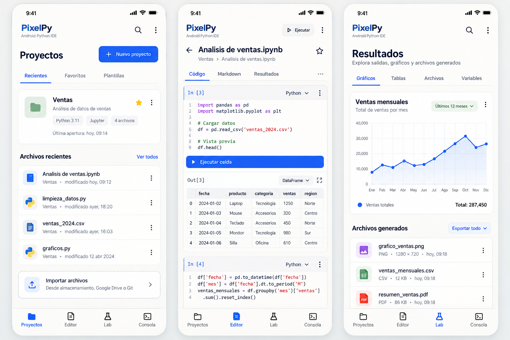
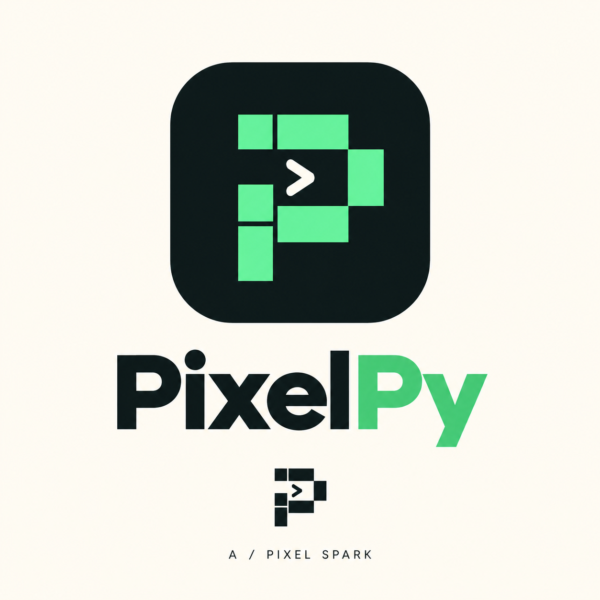
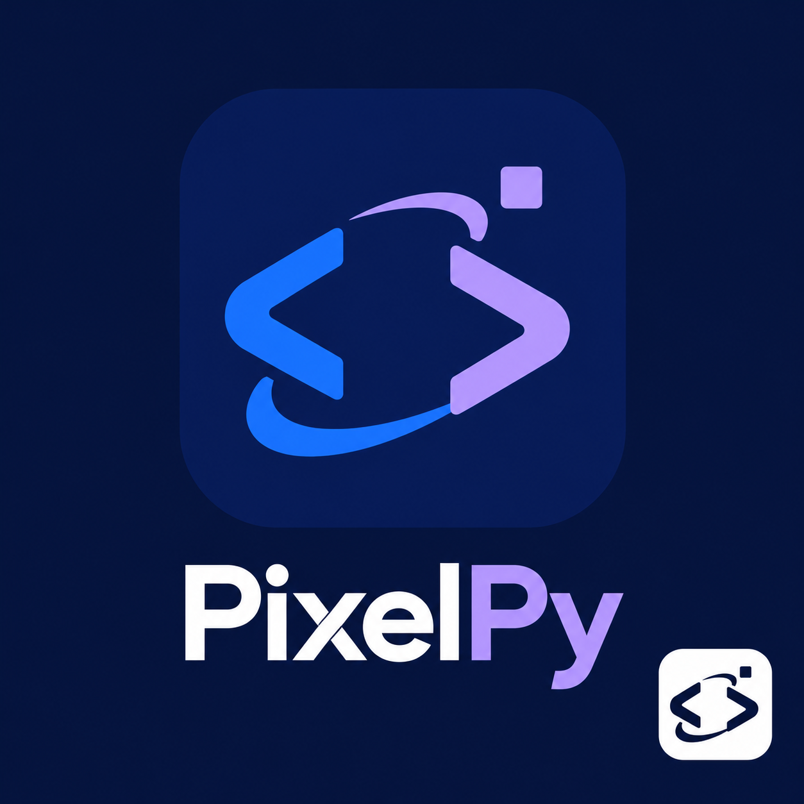
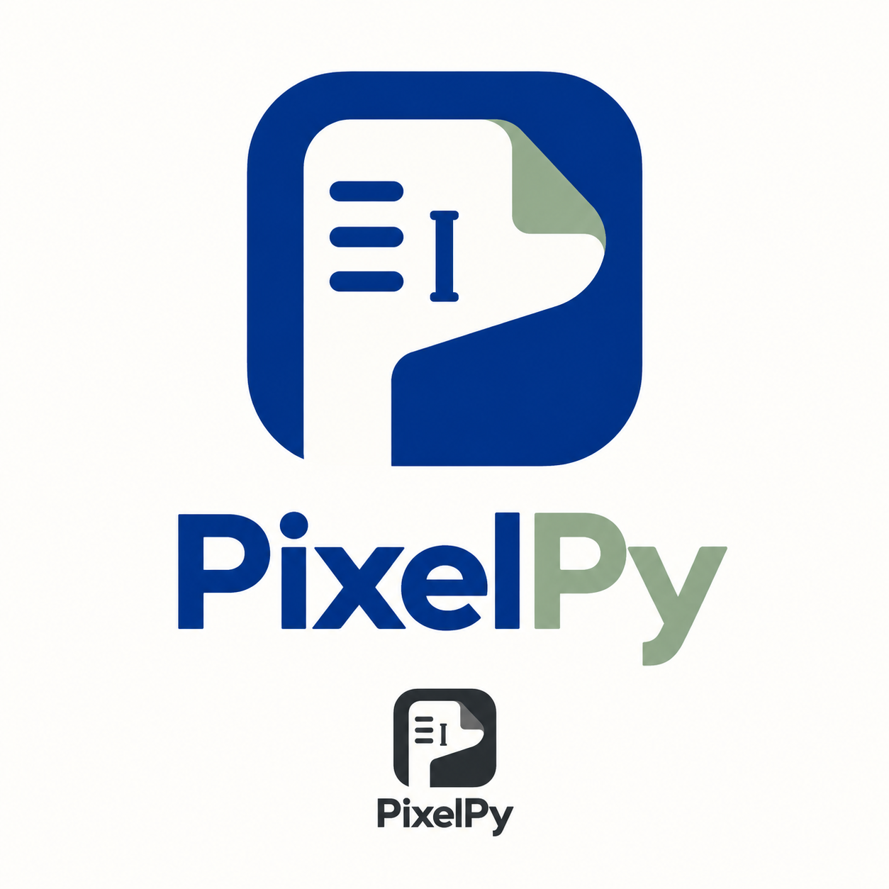

# Exploración de diseño anterior de PixelPy

Archivo histórico de conceptos exploratorios generados con la herramienta integrada de imágenes. No representan la identidad actual ni capturas de la app, y no garantizan disponibilidad de las librerías mostradas en los ejemplos. La identidad vigente es [py.Studio](../identidad-visual.md).

## Tres direcciones de interfaz

1. **Pixel Studio:** concepto inicial de crema, menta, amarillo y periwinkle.
2. **Midnight Lab:** superficies oscuras, turquesa y lavanda; enfoque en lectura prolongada de código y resultados.
3. **Paper Lab:** fondo claro, azul cobalto y salvia; estilo editorial para reducir ruido visual y destacar datos.

Cada propuesta compara Proyectos, Notebook y Resultados. Debe conservar acciones accesibles, un siguiente paso principal, selector de notebook, resultados por celda y acceso a exportación.

## Tres logos independientes

- **Pixel Spark:** P modular con bloques y terminal en negativo.
- **Code Orbit:** chevrones de código formando una órbita abierta.
- **Lab Fold:** página de notebook plegada con P y cursor en negativo.

Las propuestas y activos anteriores son archivo histórico; la identidad actual de py.Studio está definida en la [guía vigente](../identidad-visual.md).

## Briefs de generación

- Pixel Studio: tres pantallas Android en español; neobrutalismo refinado, crema y acentos menta/amarillo/periwinkle, jerarquía clara y navegación inferior.
- Midnight Lab: tres pantallas Android en español; grafito y azul marino, acentos turquesa/lavanda, sintaxis legible, controles de gráfico y tablas.
- Paper Lab: tres pantallas Android en español; papel claro, azul cobalto, salvia, separadores finos y espaciado editorial.
- Pixel Spark: icono grande y wordmark PixelPy; P pixelada geométrica, menta y tinta, prueba monocroma.
- Code Orbit: icono y wordmark PixelPy; chevrones orbitales, cobalto/lavanda sobre azul marino, prueba monocroma.
- Lab Fold: icono y wordmark PixelPy; página plegada y cursor, cobalto/salvia, prueba monocroma.
