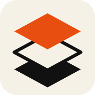

# Identidad visual de py.Studio

py.Studio presenta Python como un espacio de trabajo claro y táctil: las ideas se ordenan en capas, desde un script hasta un proyecto completo. La identidad toma como referencia el símbolo apilado de la guía entregada y se traduce a controles nativos, pantallas legibles y un editor cómodo en móvil y tableta.

## Nombre y símbolo

El nombre de producto se escribe **py.Studio**: `py` en minúsculas, punto naranja y `Studio` con inicial mayúscula. El isotipo apila tres planos: naranja arriba, una hoja crema delineada al centro y una base negra. La silueta debe mantenerse simple, con espacios visibles, para conservar legibilidad como launcher, marca de cabecera, widget y miniatura.

El banner vectorial muestra el lockup horizontal y el lema «SCRIPTS · LIBS · PROJECTS». Los recursos Android conservan el mismo orden de capas en iconos adaptativos, redondos y monocromos. El nombre de paquete `com.pixelpy.editor`, las preferencias y las rutas privadas se mantienen deliberadamente: son identificadores de compatibilidad y no forman parte del nombre visible.

## Paleta

| Rol | Color | Uso |
| --- | --- | --- |
| Naranja | `#E84E0F` | Marca, acción primaria y foco |
| Crema | `#F6F1E7` | Fondo y superficie del tema claro, texto destacado en oscuro |
| Negro | `#111111` | Tinta principal, fondo del tema oscuro y plano inferior del símbolo |
| Neutro | `#B9B3A8` | Bordes, separadores y superficies secundarias |

### Tema claro

El fondo crema y la tinta negra dan prioridad al contenido. Naranja se reserva para la acción principal, selección y foco; los bordes neutros separan superficies sin competir con el código.

### Tema oscuro

El negro cálido reemplaza el navy anterior; crema conserva contraste para textos y superficies clave. El mismo naranja representa selección y acción, y los neutros se usan con moderación para no ensuciar la lectura.

Ambos temas comparten estructura, jerarquía, espaciado y estados. Cambia la función de cada tono, no la personalidad de la interfaz. El lienzo de código puede conservar su superficie dedicada para mantener contraste de sintaxis.

## Composición y textura

- Retícula de construcción tenue como guiño a la lámina de identidad, nunca por encima de texto, controles ni código.
- Planos superpuestos como recurso de marca; tarjetas y diálogos usan elevación y borde discretos en lugar de sombras pesadas.
- Tipografía sans-serif limpia para interfaz; monoespaciada para rutas, datos y código.
- Esquinas moderadas y acciones táctiles reconocibles; sin elementos decorativos que reduzcan el espacio útil.
- En pantallas estrechas, acciones secundarias se desplazan o se agrupan en listas desplegables.

## Aplicación y estado de las capturas

El launcher, la cabecera de la app, las notificaciones y el widget deben usar la misma construcción de capas. La paleta se conserva en Editor, Notebook, Proyectos, Automatizaciones y el visor de resultados; los estados de éxito y error mantienen colores semánticos independientes del naranja de marca.

Las capturas actuales de [Proyectos, Editor y Notebook](screenshots/README.md) muestran el logo nuevo en claro y oscuro, tomadas de la preview en Tab S8 y Galaxy S25+. La galería Orbit Code permanece como registro de la marca anterior y no representa la app actual. La revisión no constituye una release; consulta el [informe de QA](QA_REPORT.md) para sus límites.
